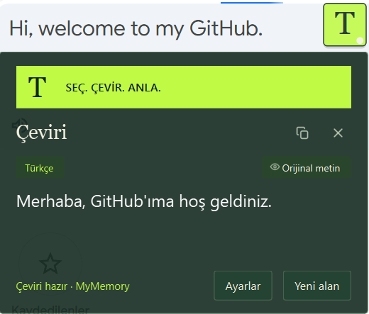
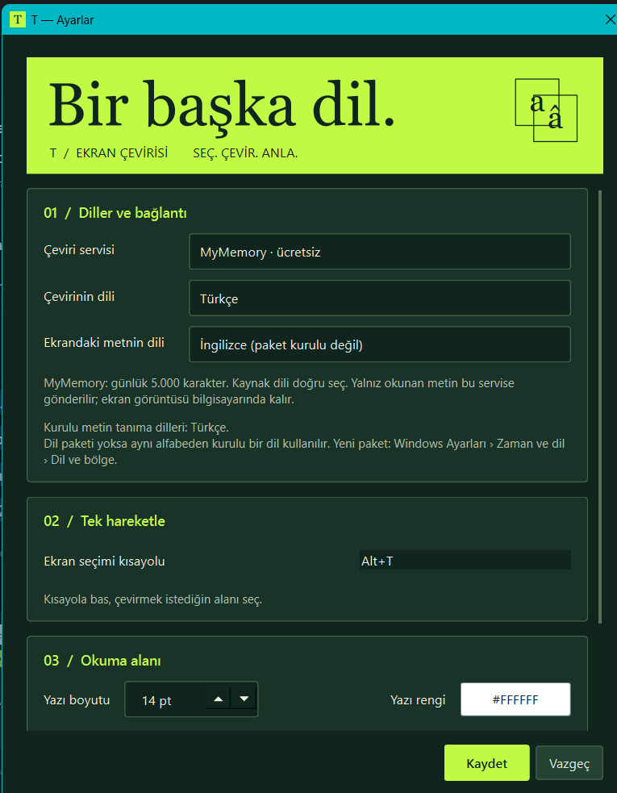

# T — Screen Translator

**Select. Translate. Understand. / Seç. Çevir. Anla.**

A small Windows app that turns any selected screen region into readable translated
text. Press **Alt+T**, draw a rectangle and read the result without switching apps.
Built with Python, PySide6 and Windows OCR. No API key required.

<p align="center">
  
</p>

[Download for Windows](https://github.com/Cemilcanoz/t/releases/latest) ·
[Türkçe](#türkçe) · [Setup](#setup) · [Privacy & limits](#privacy--service-limits)

## What it does

- Capture a region with **Alt+T**, the floating **T** button or the tray icon.
- Recognize text locally with Windows OCR, then translate through **MyMemory** or **Google**.
- Copy the translation, inspect the original, retry a failed request or select a new region.
- Keep recognized text when translation fails; cancel old work when starting a new selection.
- Adjust the languages, shortcut, text size, text color and card opacity.
- Move and resize the result card; use the floating button wherever it is convenient.

The electric green, forest green and ivory interface keeps the controls compact
and the reading area calm. Screenshots below show the Turkish UI.

<details>
<summary><strong>Settings preview</strong></summary>
<p align="center">
  
</p>
</details>

## Setup

### Windows app

Download **T.exe** from [Releases](https://github.com/Cemilcanoz/t/releases/latest).
The portable build does not require Python. Windows 10/11 and an OCR language pack
are required; translation requires internet access. The executable is unsigned,
so Windows may block it depending on your security policy.

### Run from source

Use Python **3.10+** on Windows (the current build was tested with Python 3.14).

```powershell
git clone https://github.com/Cemilcanoz/t.git
cd t
python -m venv venv
venv\Scripts\python.exe -m pip install -r requirements.txt
venv\Scripts\pythonw.exe main.py
```

Open settings directly with `venv\Scripts\pythonw.exe main.py --settings`.
The app runs in the system tray and offers to create a desktop shortcut on first launch.

## Controls

| Action | Control |
|---|---|
| Start screen selection | **Alt+T**, floating **T**, or left-click the tray icon |
| Capture a region | Drag a rectangle |
| Cancel selection | **Esc** or right-click |
| Copy / show original | Result card buttons |
| Select another region | **Yeni alan** |
| Retry without recapturing | **Tekrar dene** |
| Settings | **Ayarlar** on the card or tray menu |
| Quit / diagnostics | Right-click the tray icon |

## Privacy & service limits

**OCR stays on your computer.** Only the recognized text is sent to the selected
translation provider. The screenshot is not uploaded. Provider switching is explicit;
there is no automatic fallback to another company.

| Provider | Behavior and limits |
|---|---|
| **MyMemory** (default) | Anonymous free usage: **5,000 characters/day** and **500 UTF-8 bytes/request**. T splits long text without dropping characters. Set the source language correctly in Settings. |
| **Google** | Automatically detects the source language. Uses unofficial free endpoints that can reject requests with HTTP 429. Availability is not guaranteed. |

MyMemory uses the lookup `/get` endpoint, not the translation-memory contribution
endpoint. Quota errors remain errors, rather than appearing as translated text.
A failed chunk does not produce a misleading partial success.

Sources: [MyMemory API specification](https://mymemory.translated.net/doc/spec.php)
and [usage limits](https://mymemory.translated.net/doc/usagelimits.php).

Settings are stored at `%APPDATA%\TTranslator\config.json`. Diagnostic failures are
written to `crash.log` in the same folder; review logs before sharing them.

## OCR and troubleshooting

Install OCR language packs through **Windows Settings → Time & language →
Language & region**. Settings lists installed engines. For compatible Latin-script
languages, T can use another installed Latin-script engine; other scripts need
an appropriate OCR pack. The selected source language still determines the
MyMemory translation language pair.

For games, try windowed or borderless mode. Screen capture and overlays may not
work with exclusive fullscreen or protected content. Compatibility varies by app.

Use **Tanılama** in the tray menu, or run:

```powershell
venv\Scripts\python.exe main.py --selftest
```

The report checks OCR and live translation. A Google 429 indicates a service limit;
try MyMemory in Settings. A MyMemory quota error requires waiting for quota renewal
or selecting another provider.

## Development

```powershell
venv\Scripts\python.exe -m unittest discover -v
venv\Scripts\python.exe -m pip install pyinstaller
venv\Scripts\pyinstaller.exe T.spec --noconfirm --clean
```

The executable is written to `dist/T.exe`. The current suite has **55 tests** covering
capture geometry/DPI, OCR fallback, cancellation, retry routing, provider failures,
Unicode byte splitting and quota handling. A controlled real-screen capture →
Windows OCR → live MyMemory → result/copy flow was also verified on Windows.
This is not a compatibility guarantee for every browser, game or Windows policy.

| Module | Role |
|---|---|
| `main.py` | Tray app and background OCR/translation workflow |
| `ocr_engine.py` | Windows OCR, language fallback and image preprocessing |
| `translator.py` | MyMemory/Google transports, chunking, cancellation and retries |
| `snip_overlay.py` | Screen selection and DPI-aware cropping |
| `result_card.py`, `settings_dialog.py`, `theme.py` | Reading card, preferences and shared design |
| `floating_logo.py`, `hotkey.py` | Floating launcher and global shortcut |
| `config.py`, `crash_reporter.py`, `shortcut.py` | Local settings, diagnostics and desktop shortcut |

## Türkçe

T, ekranın seçtiğin bölümündeki yazıyı okuyup çeviren bir Windows uygulaması.
**Alt+T** ile alanı seç; çeviri kartından metni kopyala, orijinalini görüntüle veya
**Yeni alan** ile devam et. **Ayarlar** üzerinden hedef dili, kaynak dili ve görünümü değiştir.

Varsayılan MyMemory servisi günlük **5.000 karakter** ile sınırlı. Kaynak dili doğru
seçmek gerekiyor. Google seçeneği otomatik dil algılar ancak ücretsiz bağlantıları
zaman zaman engellenebilir. Ekran görüntüsü bilgisayarında kalır; yalnız okunan metin
seçtiğin çeviri servisine gider.

## License

[MIT](LICENSE)
